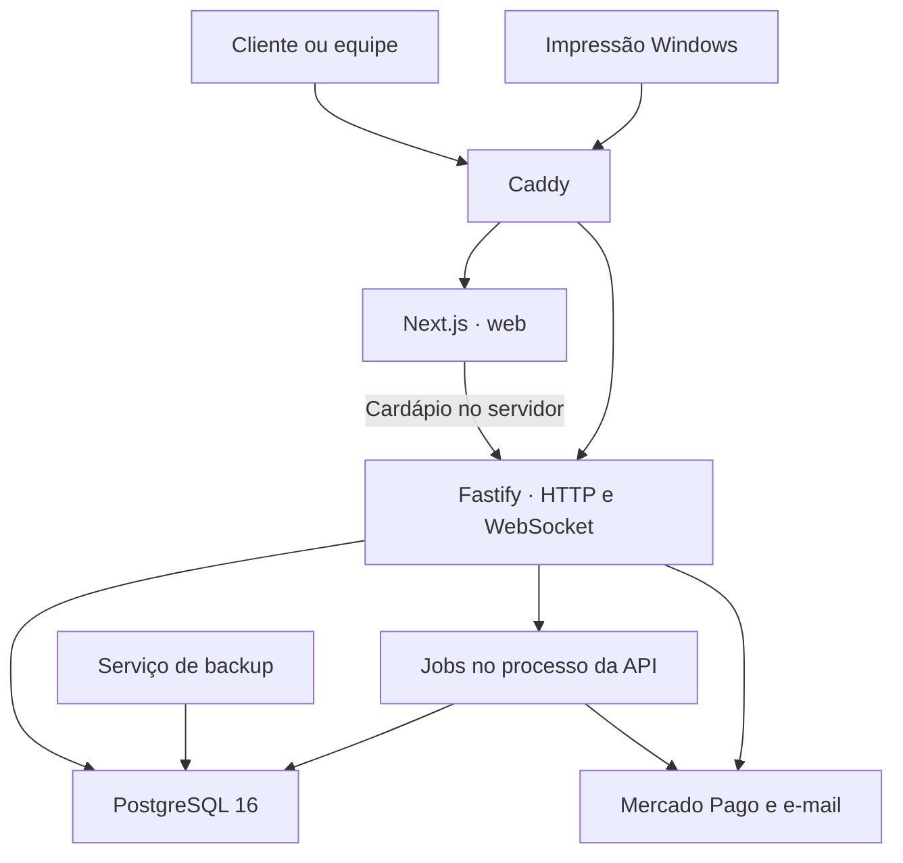
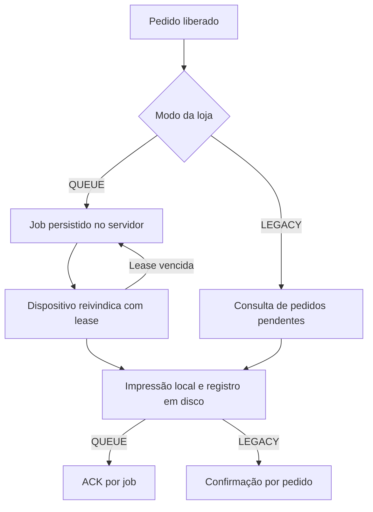

# Arquitetura do VitryNow

Mapa da cópia de desenvolvimento de 18/11/2026, incluindo a entrega do backend e os pilotos visuais CloudPOS e Ramenku. O mesmo serviço Fastify atende o cliente do restaurante, a equipe da loja e o programa Windows de impressão. PostgreSQL guarda o estado do negócio. O painel e a loja pública compartilham a aplicação Next.js, mas entram por rotas, credenciais e serviços diferentes.

O inventário do código contém **23 páginas do App Router, 108 operações HTTP, dois canais WebSocket, 32 modelos Prisma e 37 migrações SQL**. As contagens consideram arquivos `page.tsx`, registros explícitos método/caminho em Fastify e diretórios de migração. Detalhe de produto, carrinho, checkout e resultado são estados da página pública. [Rotas web](../apps/web/app) · [Montagem da API](../apps/api/src/app.ts) · [Esquema e migrações](../packages/db/prisma)

## Componentes em execução

| Peça | Responsabilidade e ponto de entrada |
| --- | --- |
| Web | Next.js 14.2, React 18 e Tailwind 3. O App Router escolhe a página, `features` concentra os fluxos, `core` contém contratos e adaptadores e `shared` fornece controles e formatação. [Aplicação](../apps/web/app) · [Features](../apps/web/features) · [Contratos](../apps/web/core) |
| API | Fastify 4 monta autenticação, CORS, WebSocket, controles de acesso, disponibilidade do PIX, jobs e rotas. O servidor verifica o fuso do banco na inicialização e encerra os serviços ao receber sinal do processo. [Servidor](../apps/api/src/server.ts) · [Composição](../apps/api/src/app.ts) |
| Pacotes | `@meucardapio/db` fornece o cliente Prisma e os tipos do banco. `@meucardapio/shared-types` contém schemas Zod e contratos de domínio e de mensagens. O web também mantém tipos próprios para os retornos que consome. [DB](../packages/db/src/index.ts) · [Schemas compartilhados](../packages/shared-types/src/index.ts) · [Domínio web](../apps/web/core/domain) |
| Cliente de impressão | WinForms em .NET Framework 4.7.2 no computador da loja. Conecta à API, monta tíquetes de 58/80 mm, envia ao sistema de impressão Windows e registra resultados localmente. [Programa](../apps/print-client/Program.cs) · [Impressão e instalação](../apps/print-client/README.md) |
| Infraestrutura | Em Compose, Caddy recebe tráfego externo. `/auth/*`, `/api/*`, `/stores/*`, `/ws/*` e `/health` seguem para a API, com bloqueio externo de `/api/admin/*`. Páginas seguem para Next. PostgreSQL usa rede de dados interna compartilhada com API, migração e backup. [Roteamento](../infra/Caddyfile) · [Serviços](../infra/docker-compose.yml) |

## Entrada no frontend

**Loja pública.** Ao abrir `/loja/[slug]`, o servidor carrega o menu pelo slug e gera HTML e metadados de compartilhamento. A cache nominal é de 30 segundos, com tratamento de loja inexistente, suspensão, falha transitória e cópia antiga. `LojaRoot` injeta os serviços de vitrine e entrega o menu inicial para hidratação. O navegador faz as próximas consultas e a criação do pedido pelo gateway público. [Busca no servidor](../apps/web/lib/serverMenu.ts) · [Entrada cliente](../apps/web/features/loja/LojaRoot.tsx) · [Gateway público](../apps/web/core/gateways/http/HttpStorefrontGateway.ts)

**Painel.** O layout de `/dashboard` cria os serviços HTTP e de tempo real uma vez. `DashboardShell` compõe contexto da loja, assinatura, upgrade, busca, ajuda e confirmação de segurança. Cada tela usa os serviços do contexto. `FetchHttpClient` traduz o retorno para sucesso com dados ou erro com status e código. A API decide quais ações, campos financeiros e transições o usuário recebe. [Shell](../apps/web/features/shell/DashboardShell.tsx) · [Fábrica dos gateways](../apps/web/core/services/createHttpPanelServices.ts) · [Cliente HTTP](../apps/web/core/http/FetchHttpClient.ts)

| Rotas e fluxo | Componentes responsáveis | Dados ou eventos principais |
| --- | --- | --- |
| `/`, `/login`, `/esqueci-senha`, `/reset-senha` | HomePage, AuthRoot, LoginPage, ForgotPasswordPage e ResetPasswordPage | Sessão e recuperação em `/auth/*`. [Entrada](../apps/web/features/home) · [Acesso](../apps/web/features/auth) |
| `/loja/[slug]` | LojaPage, StoreHeader, CategoryNav, MenuBanner, ProductListItem, ProductDetailScreen, carrinho, checkout e resultado | Loja, catálogo, disponibilidade, adicionais, quantidades e criação do pedido. A campanha estática é opcional por slug e resolve o destino pelo ID real. [Loja](../apps/web/features/loja) · [Banners](../apps/web/features/loja/banners.ts) |
| `/dashboard` | InicioPage, cards, filas, MonthChart e atalhos | Consultas de pedidos e resumo. As filas operacionais e as séries de vendas têm critérios diferentes. [Início](../apps/web/features/inicio) |
| `/dashboard/pedidos`, `/dashboard/pedidos/historico` | PedidosPage, HistoricoPage e hooks de pedido | Consulta inicial, atualizações pelo canal do painel, histórico, detalhe e ações condicionadas ao pedido. [Pedidos](../apps/web/features/pedidos) · [Gateway](../apps/web/core/gateways/http/HttpOrdersGateway.ts) |
| `/dashboard/pedidos/novo` | ManualOrderPage e ManualCatalog | Composição de pedido de balcão ou entrega a partir de produtos e adicionais da loja. O gateway transmite IDs, quantidades e condições do atendimento em `POST /api/orders`, com uma chave de idempotência. A API calcula preços e valida cupom, desconto por papel e recebimento presencial. [Entrada](../apps/web/app/dashboard/pedidos/novo/page.tsx) · [Composição](../apps/web/features/pedidos/novo) · [Regras da API](../apps/api/src/routes/manualOrders.ts) |
| `/dashboard/pedidos/pix` | PendingPixPage | Lista os pedidos aguardando PIX, consulta a situação no provedor por pedido e atualiza a fila. [Fila de pagamentos](../apps/web/features/pedidos/PendingPixPage.tsx) |
| `/dashboard/pagamentos` | StorePaymentsPage | O dono acompanha o vínculo da conta Mercado Pago, inicia a autorização e pode desconectar a conta com confirmação. [Conta de pagamento](../apps/web/features/conta/StorePaymentsPage.tsx) |
| `/dashboard/catalogo`, `/dashboard/cupons` | CatalogoPage e CuponsPage | Categorias, produtos, preço, adicionais, disponibilidade e regras de desconto. [Catálogo](../apps/web/features/catalogo) · [Cupons](../apps/web/features/cupons) |
| `/dashboard/caixa`, `/dashboard/relatorios` | ControleCaixaPage, RelatoriosPage, SummaryCards e MonthChart | Sessão e movimentos de caixa, séries e totais do período. [Caixa](../apps/web/features/controlecaixa) · [Relatórios](../apps/web/features/relatorios) |
| `/dashboard/entregadores`, `/dashboard/equipe` | EntregadoresPage e EquipePage | Entregadores, contas de equipe, papel e limites da assinatura. [Entregadores](../apps/web/features/entregadores) · [Equipe](../apps/web/features/equipe) |
| `/dashboard/impressoras`, `/dashboard/conta` | ImpressorasPage e ContaPage | Dispositivos da loja, identidade, configurações operacionais e disponibilidade. [Impressoras](../apps/web/features/impressoras) · [Conta](../apps/web/features/conta) |
| `/dashboard/impressoras/fila` | PrintQueuePage | Mostra estado, tentativas e falhas por tíquete, permite retomar impressões antigas e disponibiliza impressão de teste ao dono. [Fila de impressão](../apps/web/features/impressoras/PrintQueuePage.tsx) |
| `/dashboard/conta/entrega` | DeliveryZonesPage, ZoneEditor e ZoneRules | A equipe consulta as zonas de entrega. O dono gerencia bairros, fretes, regras e importação com prévia. [Zonas de entrega](../apps/web/features/conta/entrega) |
| `/dashboard/planos`, `/dashboard/auditoria` | PlanosPage e AuditoriaPage | Plano, assinatura, cobrança e trilha de ações. [Planos](../apps/web/features/planos) · [Auditoria](../apps/web/features/auditoria) |

CloudPOS orienta a composição administrativa e Ramenku orienta o cardápio e as peças de campanha. O layout usa dados e controles do VitryNow. A pasta `Dashboard - Front` é material de apoio separado da aplicação publicada por `apps/web`. Os frames, dimensões e adaptações intencionais estão na [matriz visual](frontend/rebrand/REFERENCIAS-FIGMA.md).

## Domínios da API e persistência

A API combina dois formatos. Em `modules`, alguns domínios têm registro de rotas, serviço e repositório separados. Em `routes`, vários handlers ainda chamam Prisma e funções de `lib` diretamente. A tabela associa as entidades persistidas ao comportamento que as altera. [Módulos](../apps/api/src/modules) · [Handlers](../apps/api/src/routes) · [Modelo relacional](../packages/db/prisma/schema.prisma)

| Domínio | Modelos Prisma | Código e contratos |
| --- | --- | --- |
| Loja, identidade e acesso | Store, User, PasswordResetToken, MfaChallenge, RevokedSession | Configuração, autenticação, recuperação, equipe e desafios. [Auth](../apps/api/src/routes/auth.ts) · [Guardas](../apps/api/src/plugins/auth.ts) · [Equipe](../apps/api/src/modules/users) |
| Oferta e entrega | Category, Product, ProductAdditional, DeliveryZone, Coupon, Deliverer | Catálogo, esgotado, entrega por bairro, frete, validade/limites de cupom e atribuição de entregador. [Catálogo](../apps/api/src/modules/catalog) · [Zonas](../apps/api/src/routes/deliveryZones.ts) · [Cupons](../apps/api/src/modules/coupons) · [Entregadores](../apps/api/src/modules/deliverers) |
| Pedido e histórico | StoreCounter, Order, OrderItem, OrderItemAdditional, OrderStatusHistory | Código por loja, dados do pedido e cópia dos itens/adicionais no momento da compra. Pedido público, manual, transição, cancelamento, histórico e reimpressão. [Loja pública](../apps/api/src/routes/storefront.ts) · [Manual](../apps/api/src/routes/manualOrders.ts) · [Pedidos](../apps/api/src/modules/orders) |
| Pagamento do pedido | Payment, PaymentAccount, PaymentOAuthState | Cobrança PIX, conta vinculada, estado do OAuth, eventos de pagamento, reconciliação e estorno. [Pagamentos](../apps/api/src/modules/payments) · [Conta por loja](../apps/api/src/modules/storePayments) |
| Caixa e relatórios | CashSession, CashMovement. O resumo também lê pedidos, itens e entregadores. | Abertura, fechamento, suprimentos, sangrias, diferenças e agregação por período. [Caixa](../apps/api/src/routes/cashier.ts) · [Cálculo financeiro](../apps/api/src/lib/saleLines.ts) · [Relatórios](../apps/api/src/routes/reports.ts) |
| Assinatura da plataforma | Plan, Subscription, SubscriptionPayment, FeatureInterest | Fases de acesso, limites de usuários/impressoras, pagamento da assinatura e registro de interesse. A cobrança da assinatura tem entidade e finalidade próprias. [Assinatura](../apps/api/src/routes/subscription.ts) · [Direitos por plano](../apps/api/src/lib/entitlements.ts) |
| Estação de impressão | DeviceToken, DeviceAlert, PrintJob | Credencial do dispositivo, fila, lease, tentativas, alertas e modo configurado na loja. [Dispositivos](../apps/api/src/routes/device.ts) · [Fila](../apps/api/src/modules/printJobs) · [Alertas](../apps/api/src/modules/deviceAlerts) |
| Auditoria e comunicação | AuditLog, Notice, NoticeRead, UserNoticeDismissal | Histórico por loja, avisos da plataforma e leituras/dispensas por usuário. Feedback gera evento de auditoria. [Auditoria](../apps/api/src/modules/audit) · [Avisos](../apps/api/src/routes/notices.ts) · [Feedback](../apps/api/src/routes/feedback.ts) |

### Como uma operação identifica a loja

- **Painel.** Login emite o cookie de sessão HTTP-only `mc_session`. A API verifica o JWT, a revogação da sessão e a versão do token do usuário. Recarrega `storeId` e papel a partir do banco. Consultas por recurso aplicam o escopo da loja. As operações de dono e as ações sensíveis têm verificações específicas, incluindo desafio MFA quando exigido. [Sessão](../apps/api/src/lib/session.ts) · [Autorização](../apps/api/src/plugins/auth.ts) · [MFA](../apps/api/src/lib/mfaGate.ts)
- **Consumidor.** O slug identifica a loja para catálogo e criação. A criação devolve um token de acesso ao pedido. Consultas de pagamento, acompanhamento e cancelamento combinam loja, ID e prova do pedido. O servidor guarda o hash do token. [Rotas públicas](../apps/api/src/routes/storefront.ts) · [Token do pedido](../apps/api/src/lib/orderToken.ts)
- **Estação de impressão.** O token individual identifica dispositivo e loja. O servidor armazena o hash, pode revogar a chave e registra atividade. O hub entrega mensagens segundo loja e audiência. [Tokens](../apps/api/src/modules/deviceTokens) · [WebSockets](../apps/api/src/routes/realtime.ts)
- **Assinatura.** O plugin aplica a política de acesso às rotas registradas. Trial, ativo, consulta e suspensão determinam ações disponíveis para loja, painel e dispositivo. Os índices e chaves compostas complementam o isolamento, por exemplo em código do pedido por loja e relação de impressão com pedido. [Portão da assinatura](../apps/api/src/plugins/subscriptionGate.ts) · [Política por rota](../apps/api/src/lib/routePolicy.ts) · [Schema](../packages/db/prisma/schema.prisma)

## Do carrinho à retirada ou entrega

1. O consumidor escolhe itens e adicionais. O navegador envia IDs, quantidades, dados de atendimento e método de pagamento. A API recalcula preços em centavos, valida disponibilidade, modalidade, zona, frete e cupom para aquela loja. O total combina subtotal menos desconto, mais taxa e gorjeta. [Gateway público](../apps/web/core/gateways/http/HttpStorefrontGateway.ts) · [Cálculo do pedido](../apps/api/src/routes/storefront.ts)
2. A transação reserva o uso do cupom de forma condicional, atribui o código e grava pedido e itens. O pedido manual segue `POST /api/orders`, com usuário do painel, canal de origem e regras próprias de desconto e repetição. [Código por loja](../apps/api/src/lib/order-code.ts) · [Pedido manual](../apps/api/src/routes/manualOrders.ts)
3. Um pedido sem cobrança PIX online pode seguir para a operação e impressão. Se há PIX online, a criação registra a cobrança com chave de idempotência e marca o pedido como aguardando pagamento. O gateway usa a conta de pagamento aplicável. O cliente acompanha a situação do pagamento usando o token. [Gateway por conta](../apps/api/src/modules/storePayments/gateway.ts) · [Fluxo do cliente](../apps/web/features/loja/hooks/useOrderFlow.ts)
4. Webhook e reconciliação aplicam transições de pagamento. A aprovação libera o pedido para operação e aciona o fluxo de impressão. A emissão de um QR e a confirmação de quitação são eventos distintos. Cancelamento, estorno pendente e estorno confirmado têm estados e eventos próprios. [Serviço de pagamentos](../apps/api/src/modules/payments/payments.service.ts) · [Estados do pagamento](../apps/api/src/lib/paymentStateMachine.ts)
5. A equipe usa a fila e o histórico. A API calcula admissibilidade das ações segundo estado do pedido, modalidade, situação financeira e papel. `SAIU_PARA_ENTREGA` é específico de delivery. O histórico guarda eventos e o hub avisa os consumidores conectados. [Estados do pedido](../apps/api/src/lib/orderStateMachine.ts) · [Kanban](../apps/api/src/modules/orders/orders.kanban.ts) · [Histórico](../apps/api/src/modules/orders/orders.history.ts)

**Venda e caixa respondem a perguntas diferentes.** Para a venda, o resumo considera pedidos confirmados até concluídos, fora da espera por pagamento. O faturamento agregado desconta a gorjeta de `totalCents`. Para a gaveta, importam a forma de pagamento, o recebimento efetivo na sessão e os movimentos. O relatório financeiro completo é do dono. A projeção de funcionário contém contagens e ranking operacional e omite campos monetários. O resumo restringe consultas a 366 dias de intervalo e 20 mil pedidos. O agrupamento diário usa São Paulo. [Definições financeiras](../apps/api/src/lib/saleLines.ts) · [Projeções do relatório](../apps/api/src/routes/reports.ts) · [Resumo de caixa](../apps/api/src/lib/cashier.ts)

## Impressão, tempo real e tarefas em segundo plano

No modo de fila, a API seleciona um trabalho elegível no PostgreSQL com `FOR UPDATE SKIP LOCKED`. O dispositivo reivindica, imprime e confirma o resultado. Um job pode ser impressão de cozinha, segunda via, aviso de cancelamento ou teste. Falhas têm recuo e limite de tentativas. A janela de retomada evita que tíquetes antigos saiam automaticamente. O programa combina WebSocket e polling e persiste o registro de impressão antes do ACK para lidar com reinícios e perda de resposta. A separação entre impressora física e banco implica que o teste real de papel/driver continua importante. [Fila e ACK](../apps/api/src/modules/printJobs/printJobs.service.ts) · [Coordenador](../apps/print-client/Services/PrintCoordinator.cs) · [Registro local](../apps/print-client/Services/PrintLedger.cs) · [Roteiro de prova física](../apps/print-client/docs/roteiro-impressora-real.md)

O hub mantém conexões WebSocket em memória, agrupadas por loja. `/ws/panel` usa a sessão do operador e `/ws/device` a credencial do dispositivo. A API pode enviar mensagens para a loja, para o painel ou somente para donos. Tanto a autorização como a recuperação do estado permanecem apoiadas nas rotas HTTP e no banco. A topologia atual precisaria de distribuição de eventos para garantir entrega entre réplicas distintas da API. [Hub](../apps/api/src/realtime/hub.ts) · [Conexão do painel](../apps/web/core/gateways/http/WebSocketRealtimeGateway.ts)

Seis jobs estão registrados no processo Fastify. O agendador inicia em `onReady`, respeita os controles de habilitação/seleção e para em `onClose`. Para disputa entre processos, os jobs contam com locks transacionais PostgreSQL e marcações dos itens processados. As conexões dos usuários e o agendamento têm ciclos de vida diferentes. [Registro](../apps/api/src/jobs/registry.ts) · [Plugin](../apps/api/src/jobs/plugin.ts) · [Locks](../apps/api/src/jobs/lock.ts)

| Trabalho | Responsabilidade |
| --- | --- |
| `techCleanup`, `queueWatch` | Limpeza técnica e acompanhamento da fila de impressão. |
| `paymentExpire`, `paymentReconcile` | Tratar cobranças vencidas e conciliar a situação do provedor com a registrada no pedido. |
| `refundRetry`, `mpTokenRefresh` | Retentar estornos elegíveis e renovar tokens de contas de pagamento. |

## Desenvolvimento, integração e entrega

| Ambiente | Execução e evidência esperada |
| --- | --- |
| Sistema local no Windows | `Abrir-VitryNow.cmd` requer Docker Desktop local no modo de contêineres Linux e Docker Compose. O iniciador gera as chaves locais, constrói a aplicação, aplica migrações e executa a carga inicial da loja Ramenku. O navegador abre o painel em `http://127.0.0.1:3000/login` após verificar a API e o login, e abre `/loja/ramenku` após verificar o cardápio. A API usa a porta 3001. O PostgreSQL mantém dados em volume próprio e o OAuth usa o modo de teste. `Abrir-VitryNow.cmd parar` encerra os serviços e preserva o volume. [Iniciador](../Abrir-VitryNow.cmd) · [Compose local](../infra/docker-compose.local.yml) · [Carga inicial](../packages/db/prisma/seed-local.ts) |
| Desenvolvimento | Node 24+, versão de pnpm declarada no manifesto e PostgreSQL 16. O Compose de desenvolvimento sobe o banco na porta 55432. Gerar o cliente Prisma, aplicar as migrações de desenvolvimento e usar o seed no banco de desenvolvimento. `pnpm dev:api` inicia a API em 3001 e `pnpm dev:web` inicia Next em 3000. [Manifesto](../package.json) · [Compose de desenvolvimento](../infra/docker-compose.dev.yml) · [Guia de execução](../README.md) |
| Testes | A CI prepara DB e shared-types antes de validar a web. O backend usa Postgres dedicado de testes e verifica migrações, drift e suíte da API. O job web executa typecheck, lint, Vitest e build. A impressão tem selftest Windows, impressora virtual e roteiro físico. [CI](../.github/workflows/ci.yml) · [Banco de testes](test-db.md) · [Selftest de impressão](../apps/print-client/run-selftest.ps1) |
| Stack e versão | Imagens de web/API/Caddy, PostgreSQL, tarefa de migração e serviço de backup. O deploy verifica ambiente e backup, executa migração e espera a saúde da pilha. `/health` inclui consulta ao banco. O rollback de imagens e a restauração de dados são operações distintas descritas no runbook. [Compose](../infra/docker-compose.yml) · [Deploy](../infra/deploy.sh) · [Saúde](../apps/api/src/routes/health.ts) · [Runbook](RUNBOOK-infra.md) |
| Recuperação | O serviço de backup executa cópias periódicas. O projeto inclui verificação de restauração e roteiro para preservar ações irreversíveis em uma recuperação. [Scripts de backup](../scripts/backup) · [Teste de restauração](../scripts/test-backup-restore.sh) |

### Limites para homologação

- O estado declarado pelo projeto é desenvolvimento. A implementação inclui gateway falso e adaptador real do Mercado Pago. O modo falso só é aceito em desenvolvimento/teste e as credenciais reais exigem configuração e homologação. O e-mail tem integração Resend e caminho de teste. [OAuth](../apps/api/src/modules/storePayments/oauth.ts) · [E-mail](../apps/api/src/lib/email.ts) · [Estado do projeto](../README.md)
- `MESA` é uma modalidade de pedido. Comandas, QR por mesa e pagamento dividido requerem seus próprios modelos, rotas e experiência. O link para conversar por WhatsApp no resultado do pedido tampouco representa um serviço de disparos ou atendimento automatizado. [Schema](../packages/db/prisma/schema.prisma) · [Resultado do pedido](../apps/web/features/loja/components/OrderResultScreen.tsx)
- Compare as capacidades da API com o gateway e a tela ao estimar entrega. Acompanhamento público detalhado e `payment-status` são recursos separados. Gestão da fila e emissão de chave de impressora também passam por contratos diferentes. Uma rota registrada não comprova que todos os seus controles estão publicados no painel. [Gateway da loja](../apps/web/core/gateways/http/HttpStorefrontGateway.ts) · [Serviços do painel](../apps/web/core/services/createHttpPanelServices.ts)
- Para homologar uma versão, conferir no mesmo conjunto de código o pedido público, o manual, perfis dono/funcionário, pagamento liberado/pendente, estorno, estoque e uma impressão real. Este inventário descreve a estrutura observada no checkout. Aprovação do provedor de pagamentos, deploy e impressão física exigem evidência de execução própria.
