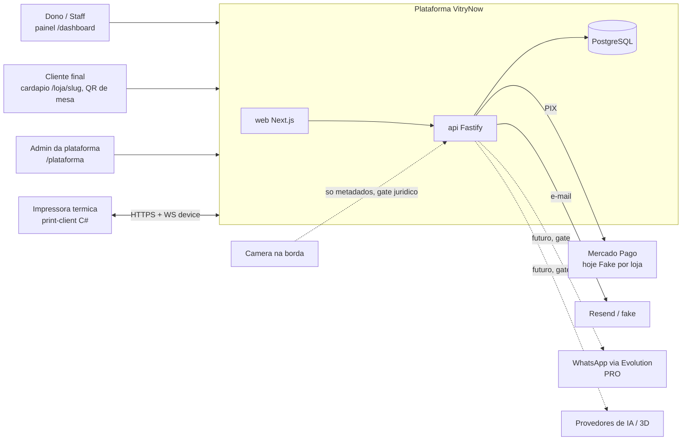
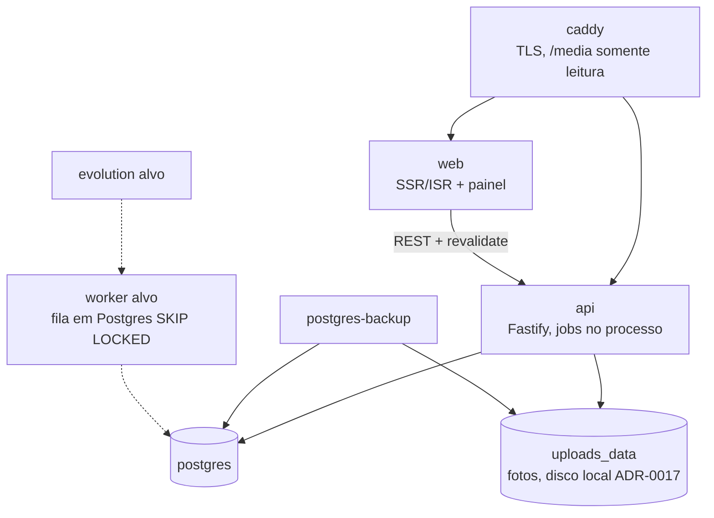
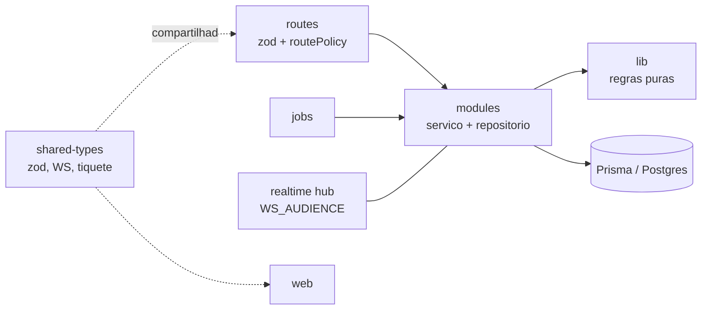
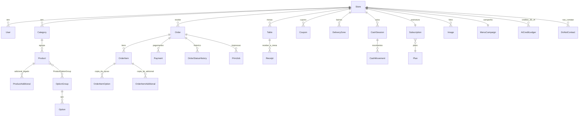
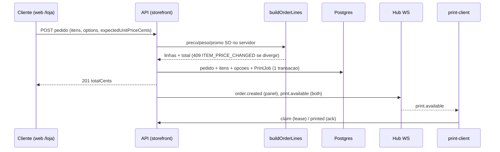
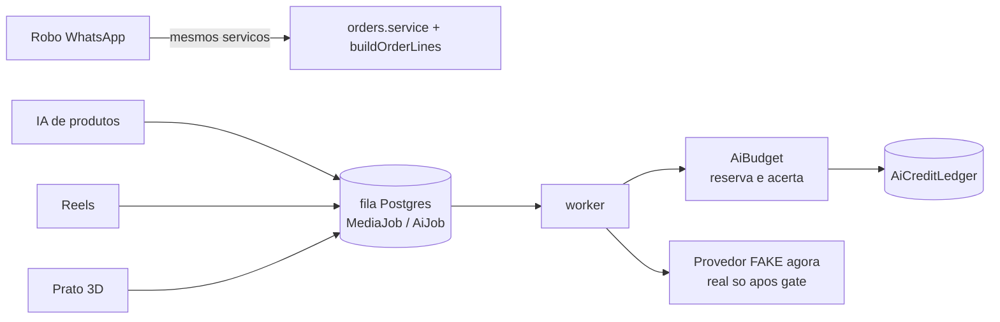

# ARQUITETURA — Cardápio / VitryNow (Atlas, 19/11/2026)

**Base lida:** `main` `babcbd6` (nomes de pastas, modelos Prisma, chaves de lock dos jobs, `WS_AUDIENCE`, serviços do compose, rotas do web). **Relato** = outro agente; **não verificado** = não li no código. Insumos: Hopper (documento interno do time), Nightingale (`…--parte-NIGHTINGALE.md`), Tesla (documento interno do time), `SSOT.md`, ADRs 0001–0017.
**Princípio:** construir uma estrutura que continue funcionando quando o projeto crescer; uma só regra por dado (`SSOT.md`); função nova só atrás de **gate** do Claudio.

## 1. Contexto (quem fala com o sistema)

Nada em produção hoje: tudo é DEV; Mercado Pago real e e-mail real estão fora (decisão do Claudio).

## 2. Contêineres
**Hoje (`infra/docker-compose.yml`):** `postgres`, `migrate` (aplica migrações e sai), `api`, `web`, `caddy` (HTTPS, proxy, `/media`), `postgres-backup`; volumes `postgres_data`, `uploads_data`, `caddy_*`.
**Alvo (sem custo até o gate):** + `worker` (mesma imagem da API, só consome filas), + `evolution` (uma instância por loja, só com o Fake em teste), + prefixos de mídia novos. Detalhe e custos de infra: parte do Hopper.

## 3. Módulos do backend (`apps/api/src`)
Camadas: **`routes/` (HTTP, validação zod, `routePolicy`)** → **`modules/*` (serviço + repositório por tema)** → **`lib/` (regras puras e utilitários)** → **Prisma**. Jobs em `jobs/`, tempo real em `realtime/`, plugins em `plugins/`.
| Camada | Conteúdo (lido) |
|---|---|
| `routes/` | auth, cashier, deliveryZones, device, feedback, health, manualOrders, menuCampaign, mfa, notices, onboarding, platform, realtime, reports, store, storefront, subscription, tables |
| `modules/` | audit, campaign, catalog, coupons, deliverers, deviceAlerts, deviceTokens, media, optionGroups, orders, payments, printJobs, privacy, storeHours, storePayments, users |
| `lib/` (regras) | `orderItems.ts` (**única autoridade de preço do item**), `orderStateMachine.ts`, `paymentStateMachine.ts`, `entitlements.ts`, `routePolicy.ts`, `menuView.ts` + `publicDto.ts` (DTO público), `storeTime/storeDay.ts`, `printable.ts`, `saleLines.ts`, `refundPolicy.ts`, `securityEvents.ts`, `captcha.ts` (Fake), `objectStorage.ts` |

**Regras estruturais (já impostas por teste):** toda rota de escrita tem classe em `routePolicy` (teste de contrato falha sem ela); guardas devolvem `return reply...send` (SEC-40); IP só por `clientIpOf`; DTO público por lista de permissão com chaves exatas (SEC-18).

## 4. Modelo de dados (ER simplificado)
Modelos presentes no schema (lido): Store, Table, StoreCounter, User, DeviceToken, Category, Product, ProductAdditional, OptionGroup, Option, ProductOptionGroup, Order, OrderItem, OrderItemAdditional, OrderItemOption, OrderStatusHistory, Payment, PaymentAccount, Coupon, DeliveryZone, Deliverer, CashSession, CashMovement, Receipt, ReceiptPayment, PrintJob, DeviceAlert, Plan, Subscription, SubscriptionPayment, SubscriptionNotice, Notice, Image, MenuCampaign, MenuRevalidation, Feedback, DoNotContact, AuditLog, OnboardingStep, ActivationEvent, MfaChallenge, RevokedSession, PlatformAdmin, PlatformAuditLog, **AiCreditLedger**, FeatureInterest. *(Relações abaixo: principais; cardinalidades finas não conferidas linha a linha.)*

**Isolamento por loja:** todo dado de negócio tem `storeId`; a API-48 (#144) impõe **FKs compostas `(id, storeId)`** entre Product→Category, Order→Coupon/Deliverer/Receipt, ReceiptPayment→Receipt (o banco recusa referência entre lojas). **Limite conhecido (API-48b, backlog):** OrderItem, ProductAdditional, OrderItemAdditional/Option, OrderStatusHistory, CashMovement e Payment não têm `storeId` próprio; o isolamento delas depende da FK do pai.
**Dinheiro:** centavos inteiros (Int/Int8 no caixa). **Preço do item (RN-B8-03):** `OrderItem.unitPriceCents` = base + opções SUM; adicional legado soma por cima; venda por peso (produto detalhado): `quantity = 1`, `weightGrams`, valor da linha calculado só no servidor.

## 5. Eventos, jobs e tempo real
**Jobs (no processo da API, com `pg_try_advisory_xact_lock` por chave; o runner recusa chave repetida):** `payment.reconcile 7001`, `payment.expire 7002`, `refund.retry 7003`, `mp.token.refresh 7004`, `subscription.transition 7005`, `subscription.notices 7006`, `schedule.release 7007`, `message.outbox 7008`, `tech.cleanup 7009`, (7010 `print.queue_watch`), `menu.revalidate 7011`. Periodicidades: ver `jobs/LEIAME.md` (**não verificado** aqui).
**Tempo real:** hub WebSocket por **audiência** (`WS_AUDIENCE`: `panel` | `device` | `both`; impressora só recebe `print.available`; filtro fail-closed). Eventos: `order.created/updated/cancel_notice`, `payment.refund_*`, `payment.reconcile_needed`, `print.*`, `table.alert`, `cashier.difference_over_tolerance`, `device.alert`.
**Máquinas de estado:** pedido (`orderStateMachine.ts`, ADR-0007) e pagamento (`paymentStateMachine.ts`); impressão com lease/ack (ADR-0004), janela de 12 h (STALE).

## 6. Segurança (camadas)
Sessão JWT com `tokenVersion` (ADR-0008) + MFA para ações sensíveis (`MFA_PURPOSES`) · `routePolicy` (classes `blocked/finish/allowed/billing/export` e públicas) · throttle de login por IP/conta · DTO público por allowlist · isolamento por loja (FK composta) · CSP e cabeçalhos (NG-07; **ainda `unsafe-inline`, item SEC-41**) · `clientIpOf` + `TRUST_PROXY_CIDR` · eventos de segurança com alertas por limiar (`securityEvents.ts`, 7 regras) · captcha plugável (Fake) · LGPD técnico atrás de `PRIVACY_ACTIONS_ENABLED`. Repositório PÚBLICO: histórico sem segredo real (scan da Nightingale); **proteção da main desligada** (pendência do titular). Detalhe por função nova: parte da Nightingale.

## 7. Onde entram as funções novas (TODAS atrás do gate do Claudio)
| Função | Onde entra | Reaproveita | Custo variável | Pré-requisito |
|---|---|---|---|---|
| **Robô WhatsApp** (PRO; Evolution, ADR-0006 v2) | módulo `modules/whatsapp` + intents fechadas (camada A menu numerado sem IA; camada B texto livre opcional dentro do teto); **MAIS UM CANAL** do mesmo serviço (`source=WHATSAPP`) | `message.outbox` (7008), `DoNotContact`, `routePolicy`, `entitlements` | mensagens (Meta, paga pela loja) + IA se houver | **extrair `OrderService.create` único (SSOT D12: hoje há 3 caminhos de criação)**, spec do Leonardo (documento interno do time), opt-in/LGPD, simulador Fake |
| **IA de produtos** (texto/foto) | job assíncrono `AiJob` na fila Postgres; saída é **rascunho** que o dono aprova | **`AiCreditLedger`** (reserva → confirma/estorna) | sim: teto R$ 50–100/loja/mês | `AiBudget` + provedor Fake |
| **Reels** | `MediaJob` (transcodificar em processo isolado, quarentena) → R2/MP4 faststart (ADR-0015); P2P fora do MVP | fila única, `imageLane` | armazenamento/banda | medir antes; ADR de mídia pesada |
| **Prato 3D** | `MediaJob` + Tripo (suboperador); créditos manuais pelo back-office | `AiCreditLedger` | sim (crédito) | preço do crédito (Claudio) |
| **Restaurante 3D** | depois do prato 3D | idem | sim | gate |
| **Visão computacional** | **na borda**, só metadados/linha do tempo da mesa (ADR-0016) | `table.alert`, `Table` | hardware do cliente | parecer jurídico/RIPD |

**Fundações SEM custo (podem entrar antes do gate, uma por PR):** (0) `OrderService.create` único com `origin` (refatoração sem função nova); (1) fila Postgres + `worker` + alertas; (2) `AiBudget` com provedor Fake sobre o `AiCreditLedger` existente; (3) flags por plano em `entitlements`; (4) simulador Fake do robô. **Ordem proposta (Hopper):** fila/worker → AiBudget Fake → robô com Fake → mídia → IA → Reels → 3D; visão só após parecer jurídico.

## 8. Custos
Teto por loja **R$ 50–100/mês** (decisão do Claudio) vale para IA/mídia; o preço cobrado do lojista é **[DEFINIR]** e só depois do custo medido. **Não há estimativa de custo por loja nem de hospedagem da Evolution:** falta preço vigente dos provedores e medição (RAM/CPU com 1, 10 e 50 instâncias só com Fake). Nenhuma função com custo é anunciada como "ilimitada" ou "grátis".

## 9. Decisões e riscos em aberto
- **ADRs novos:** 0018 (fonte única de verdade), 0019 (fundações e gate das funções novas).
- **Riscos:** D1/D2 do SSOT (fuso e horário) são os de maior risco ao cliente; isolamento das tabelas filhas (API-48b); CSP com `unsafe-inline`; proteção da main desligada; INF-06 (staging) sem servidor; jurídico (LGPD P1–P17, câmeras, revenda Tripo).
- **Gate:** o Claudio aprova este desenho antes de qualquer código de robô, IA, Reels, 3D ou visão.
