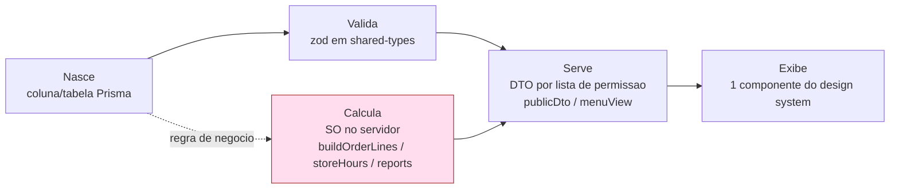

# SSOT — Mapa de FONTE ÚNICA DE VERDADE (Atlas, 19/11/2026)

**Base lida:** `main` do GitHub `babcbd6` (git grep / git show). O que veio de relato de outro agente está marcado **(relato)**; o que não pude ler está marcado **não verificado**. Insumos: Tesla (documento interno do time, base `f58e2ef`), Ogilvy (§6 do lado comercial).

## 1. A regra (uma frase)
> Cada dado **nasce** em UM lugar (coluna ou tabela), é **validado** por UM esquema (zod em `packages/shared-types`), é **servido** por UM DTO e é **exibido** por UM componente. Quem precisa do dado **pede**; ninguém **recalcula** nem **redeclara**.

Exceção permitida e nomeada: o web pode **simular** um cálculo só para PRÉVIA, desde que (a) o servidor recalcule e seja a autoridade e (b) divergência vire erro explícito (hoje: `expectedUnitPriceCents` → 409 `ITEM_PRICE_CHANGED`).

## 2. Mapa: onde cada dado nasce, valida, serve e exibe

| Dado | Nasce (verdade) | Valida | Serve | Exibe | Situação |
|---|---|---|---|---|---|
| **Preço do produto** | `Product.priceCents` (centavos inteiros) | `createProductSchema` | `publicDto` (`PUBLIC_PRODUCT_KEYS`), `menuView` | componente de preço da loja | OK; ver D5 (prévia no web) |
| **Preço do ITEM no pedido** | `OrderItem.unitPriceCents` = base + opções SUM (RN-B8-03); adicional legado à parte | `createOrderItemSchema` | `buildOrderLines` (`lib/orderItems.ts`) é a ÚNICA autoridade (vitrine, mesa, rodada, manual) | detalhe do pedido: `unit × qtd` | OK desde o #128; web prévia: `cartPricing.ts` |
| **Promoção / peso** (produto detalhado) | `promoCents`, `saleUnit`, `pricePerKgCents` (migração `…790000`) | zod novo | `buildOrderLines` (nunca o cliente) | cardápio "de/por", "por kg" | A CRIAR com SSOT desde o início |
| **Horário de funcionamento** | **`Store.schedule` (JSON)** | `validateSchedule` (`storeHours.domain.ts`) | `acceptingWindows`/`nextOpening` | selo "Aberto agora", cabeçalho | **DUPLICADO ×3: ver D2** |
| **Fuso** | `Store.timezone` | — | já vem da API ao painel | todas as datas/horas | **DUPLICADO: ver D1** |
| **Status do pedido** | enum Prisma `OrderStatus` + `orderStateMachine.ts` | `orderStatusSchema` (shared-types) | respostas da API | `STATUS_LABELS` (`orderLabels.ts`) | **REDECLARADO no web: D3** |
| **Papéis** | enum Prisma `UserRole`, `PlatformRole` | `createStaffUserSchema` | JWT/sessão | telas de equipe | **REDECLARADO no web: D4** |
| **Plano, preço, recursos** | tabela `Plan` (+ `Plan.features`) | — | `/api/store/subscription` | tela de planos | risco D7 |
| **Limites do plano** | `Plan.limits` + `BASICO_LIMITS` (fallback, `entitlements.ts`) | `limitValue` | entitlements por loja | bloqueio por plano | OK (servidor decide) |
| **Taxa de entrega / frete grátis** | `DeliveryZone`, `Store.deliveryFeeCents`, `freeShippingFromCents` | schemas de zona | servidor calcula no pedido (`lib/deliveryZones.ts`) | checkout | **web recalcula: D5** |
| **Cupom** | `Coupon` | schema do cupom | servidor valida e aplica | campo de cupom | OK (regras só no servidor); mínimo do pedido no web é só exibição |
| **Tema da loja** | `Store.primaryColor` (hex) | hex no schema | `publicDto` | `lojaThemeStyle` | OK p/ a loja; **109 hex fora dos tokens (relato Tesla): D8** |
| **Telefone, id/código do pedido** | `phoneSchema`; `order-code.ts` | shared-types | DTO | máscara/formatação | **formato repetido no web (relato Tesla): D9** |
| **Eventos em tempo real** | `WS_AUDIENCE` (shared-types) | `wsServerMessageSchema` | hub por audiência | painel/impressora | **EXEMPLO CERTO** |
| **Contrato do tíquete** | `printableOrderSchema` + `TICKET_SCHEMA_VERSION` | zod | `GET /api/device/orders/:id/printable` | print-client (C#) | **C# reimplementa o contrato: D10** |
| **Código de erro** | `code` estável (ex.: `ITEM_PRICE_CHANGED`) | — | `{ error, code, details }` | tratador de erro do web | texto sem catálogo único: D6 |
| **Limites numéricos** (30/200 seleções, 366 dias, 300 req/min…) | constantes na API | — | — | mensagens no web | cópias possíveis: D11 (não verificado) |

## 3. DUPLICAÇÕES ENCONTRADAS (lidas na main) e plano de correção

Ordem = prioridade (risco ao cliente × custo). **PR = um tema por PR**; dono sugerido entre parênteses.

### D1 — FUSO fixo `America/Sao_Paulo` (RISCO ALTO para loja fora de SP)
- **Onde:** API em ~5 arquivos (`cashier.ts`, `soldOut.ts`, `sqlTime.ts`, `storeDay.ts`, `storeTime.ts`, `orders.service.ts`; **fonte da API = `lib/storeDay.ts`**); web em ~10 (**Turing: 14 arquivos no total**) (`AuditoriaPage`, `LogRow`, `CouponRow`, `couponForm`, `salesDefinition`, `OrderDetailView`, `PixCheckoutModal`, `PlatformUi`, `PrivacyPage`). Existe `Store.timezone`, e a API o devolve ao painel (relato Tesla: 6 pontos de exibição).
- **CORREÇÃO (Tesla, base `9da9bd3`):** o problema é MAIOR: 8 pontos do web com `America/Sao_Paulo` fixo (Auditoria, couponForm, salesDefinition→Início ×2 e CurrentOrdersCard, OrderDetailView, Privacidade, relatorios/dateRange) **e ~25 pontos que formatam data SEM fuso** (fuso do computador de quem olha: Caixa, Controle de caixa, Impressoras, Planos, Plataforma, PendingPix; na loja pública OrderResult/OrderTracking/OrdersScreen); só o Histórico usa o fuso da loja. **E a API só devolve `Store.timezone` na resposta do Histórico**: não vem em `GET/POST /api/store/settings` nem no DTO público: **PR-04b** (campo `timezone`, plano a5) vem ANTES do PR-05. Loja pública: recomendo o fuso da LOJA (decisão de produto, a confirmar).
- **Correção:** (1) API: uma constante `DEFAULT_STORE_TIMEZONE` só em `storeTime.ts`, o resto recebe `store.timezone`; (2) web: um hook/`formatInStoreTimezone(date, tz)` e **nenhum literal de fuso fora dele**; (3) teste-guarda: `git grep "America/Sao_Paulo"` fora de 2 arquivos permitidos falha. (Turing API; Tesla web; Deming guarda.) **Ordem 1.**

### D2 — HORÁRIO: três fontes (RISCO ALTO)
- **Fatos:** `Store.schedule` (JSON) é a regra do servidor (`storeHours.domain.ts`: `acceptingWindows`, `nextOpening`, exceções); `Store.openingHours` (texto livre, "só informativo") é lido em ~11 arquivos do web, e **o web reimplementa "aberto agora"** interpretando esse texto (`apps/web/lib/openingHours.ts: isStoreOpenNow`). O onboarding conta HOURS como feito se houver grade **ou** texto. Resultado possível: a vitrine mostra "Aberto" pelo texto enquanto o servidor recusa pedido pela grade.
- **Correção:** `schedule` é a única verdade. (1) O servidor devolve no DTO público `openNow`, `nextOpensAt` e um **texto de horário gerado** a partir de `schedule`; (2) remover `isStoreOpenNow` e o campo texto livre da tela (migração de dados: gerar a grade a partir do texto onde der, senão avisar o dono); (3) `openingHours` fica somente leitura/legado e some depois de uma versão; (4) teste-guarda: o web não importa `openingHours.ts`. Migração aditiva primeiro, remoção depois. (Babbage API; Tesla web.) **Ordem 2.**

### D3 — STATUS do pedido redeclarado
- **Onde:** `apps/web/core/domain/orders.ts` define `ORDER_STATUSES`/`OrderStatus`; `features/inicio/services/currentOrders.ts` redeclara `FINISHED`; `features/pedidos/kanban.ts` `KANBAN_COLUMNS`; a API tem `FINAL_STATUSES`/`IN_PREPARATION` (`orderStateMachine.ts`) **e a lista PENDENTE…CANCELADO escrita à mão em `orders.history.ts` e `routes/tables.ts`** (Turing: 4 lugares, D-03). `orderStatusSchema` existe em shared-types, mas **o enum em si não** (Turing): mover o enum para lá.
- **Correção:** `ORDER_STATUSES`, `FINAL_STATUSES` e as transições exportados de shared-types; web importa. Rótulos (`STATUS_LABELS`) ficam só no web (é exibição). Renomear um dos dois `statusLabel` (pedido × onboarding, relato Tesla). Guarda: nenhum literal `"EM_PREPARO"` fora de shared-types, `orderStateMachine.ts` e testes. (Turing + Tesla.) **Ordem 4, baixo risco, mecânico.**

### D4 — PAPÉIS redeclarados
- **Onde:** `"OWNER" | "STAFF"` em ≥6 arquivos do web (`cashier.ts`, `orderDetail.ts`, `users.ts`, `AuthGateway.ts`, …).
- **Correção:** `PANEL_ROLES`/`PanelRole` em shared-types. **Ordem 5.**

### D5 — TOTAL e FRETE recalculados no web (RISCO MÉDIO-ALTO, dinheiro)
- **Onde:** `loja/checkoutForm.ts` (`totalCents = subtotal + frete + gorjeta`) e `CheckoutDrawer.tsx` (limiar de frete grátis, taxa por zona) repetem a regra do servidor. Já existe a rede de segurança: o servidor recusa com 409 e devolve `details {deliveryFeeCents, totalCents}`, e o web se corrige.
- **Correção:** uma função pura `quoteOrder()` em shared-types usada pelos DOIS (o web só para prévia) **ou** um endpoint de cotação; nos dois casos o teste cruzado "web == servidor" para ~20 casos. Sem isso, qualquer regra nova de frete (bairro, API-16) nasce duplicada. (Babbage + Tesla.) **Ordem 3.**

### D6 — TEXTOS de erro sem catálogo único — **API e catálogo FEITOS; ligação no web = PROPOSTA para o frontend** (docs/PARA-O-FRONTEND.md §2)
- **Feito (fora do web):** catálogo `errorMessages` em shared-types (subpath `@meucardapio/shared-types/errors`, marcador `ok()` = texto aprovado); guarda da API (`error-catalog-guard.test.ts`); lista para revisão `docs/textos-de-erro-para-revisar.md` (`node scripts/textos-de-erro.mjs`).
- **Fatos:** o servidor manda `{ error, code }`; o `code` é estável, o texto não tem dono (a API tem texto em português nas respostas, o web tem os dele; Ogilvy pede catálogo único para telas, e-mail e WhatsApp). Mapa de mensagens do web **não verificado**.
- **Correção:** `code` é o contrato; um catálogo `messages[code]` por superfície (painel, loja, e-mail, WhatsApp) em shared-types; o `error` da API vira só diagnóstico. Guarda: todo `code` novo exige entrada no catálogo (teste que lista os `code:` no código). (Leonardo catálogo; Babbage guarda.) **Ordem 6.**

### D7 — PLANO: preço, nome e recursos só na tabela `Plan` (comercial, Ogilvy §6)
- **Risco:** `49,90`/`99,90` ou nomes digitados em tela, e-mail ou página de vendas; `planPresentation.ts` com a lista de recursos (**não verificado**).
- **Correção:** a tela de planos só mostra o que `GET` devolve; guarda: `git grep` por padrão `\d{2},\d{2}` em textos de planos falha. **Ordem 7.**

### D8 — CORES, z-index e breakpoints — cores, camadas e larguras **APLICADOS** (camadas: tokens `--z-*` em `shared/design/tokens.css`; larguras 340/480/800/1100; guarda `shared/design/layers.test.ts`) (docs/PARA-O-FRONTEND.md §1 e §3; o web existente é do sócio)
- **Mais (Da Vinci, documento interno do time):** 69 hex soltos só em CSS de feature; camadas de z-index sem escala (1 uso em `100000000`; a causa do #35); **12 larguras de breakpoint diferentes** (proposta: 2); o texto de situação "Em preparo" aparece em 4 arquivos fora de teste (**não verificado** se copiam o texto: ligado a D3). Menu, barra do celular e busca **já** leem UM arquivo (`core/navigation/panelNavigation.ts`): é o exemplo certo de fonte única no web.
- **Correção:** tokens semânticos (ok/aviso/perigo/info) pelo Da Vinci/sócio (propostas P-01..P-12 a aprovar pelo sócio); cor da loja continua `Store.primaryColor` via `lojaThemeStyle`. Guarda: lint que proíbe hex fora de `tokens.css`/tema da loja. **Ordem 8.**

### D9 — TELEFONE e ID de pedido: máscara/formato repetidos no web (relato Tesla)
- **Correção:** `formatPhone`/`formatOrderCode` num lugar do web; formato do código nasce em `order-code.ts`. **Ordem 9.**

### D10 — Contrato do TÍQUETE em dois idiomas
- **Fato:** `printableOrderSchema` (TS) e `TicketBuilder.cs` (print-client) descrevem o mesmo tíquete; o print-client **soma** `additionals` ao unitário (por isso o tíquete usa unitário = base, #126).
- **Correção:** gerar JSON Schema a partir do zod e testá-lo contra os fixtures do C#; `TICKET_SCHEMA_VERSION` muda junto. (Turing + Ritchie.) **Ordem 10.**

### D11 — LIMITES numéricos e DINHEIRO
- Limites (30/200 seleções, 366 dias, 300 req/min…) devem sair de um objeto `LIMITS` exportado quando o web os mostrar (**não verificado** se há cópia).
- **Dinheiro:** web tem `formatCents` (`shared/format/money.ts`) **e** um `Intl.NumberFormat("pt-BR")` solto (`CashHistory`); a API tem `formatBRL` (`cancelMessages.ts`); 3 componentes mostram o valor "oculto" com textos diferentes (relato Tesla). A mensagem "pedido mínimo é R$ …" é montada à mão **3×** (`storefront.ts`, `tables.ts`, `manualOrders.ts`; Turing D-04/06). O texto do **429** tem 3 frases em 4 arquivos (Turing D-05; a API-64, commit `e8283e9`, unifica o corpo da API). **Correção:** um `formatCents` e um `minOrderMessage()` em shared-types, um componente `<Money hidden>`. **Ordem 5.**

### D12 — CRIAÇÃO DO PEDIDO em três caminhos (pré-requisito do robô; RISCO MÉDIO)
- **Fato (Leonardo + leitura):** o preço do item já é UMA autoridade (`buildOrderLines`), mas a **criação do pedido** (transação, cupom, frete, taxa, mínimo, token, impressão, eventos) tem caminhos separados: cardápio (`routes/storefront.ts`), QR de mesa (`routes/tables.ts`) e manual do painel (`routes/manualOrders.ts`). O robô de WhatsApp seria o 4º.
- **Correção:** extrair `OrderService.create({ origin, items, customer, … })` em `modules/orders`, com `origin = STOREFRONT | TABLE | MANUAL | WHATSAPP` (`Order.source` já existe) e as rotas só traduzem HTTP; teste cruzado: o mesmo pedido pelos 3 caminhos dá o mesmo total, o mesmo tíquete e os mesmos eventos. **Antes de qualquer código do robô.** (Babbage + Turing; Deming valida.) **Ordem 3b, junto de D5.**

### D13 — Web ↔ API (Deming, documento interno do time seção "Web ↔ API", DUP-W01..W08, base `168dcb5`)
| Id | Tema | Fato | Risco | Correção | Fila |
|---|---|---|---|---|---|
| W01 | **Forma de pagamento** | a lista `DINHEIRO\|PIX\|CREDITO\|DEBITO\|VR\|VA` está em 6 arquivos do web, 2 da API (`saleLines.ts`, `reports.ts`), em shared-types e em 4 pontos do print-client (C#) | **ALTO (dinheiro)** | `orderPaymentMethodSchema` como única lista + UM catálogo de rótulos; C# gera/testa a lista a partir do mesmo contrato | PR-09b (antes do 10) |
| W02 | Horário | `isStoreOpenNow` do web (texto livre + relógio do NAVEGADOR) **sem nenhum uso hoje** | médio | remover no PR-02 | PR-02 |
| W03 | Fuso do navegador | 12 datas com `toLocaleString("pt-BR")` sem `timeZone` em 11 arquivos | médio | `formatInStoreTimezone` | PR-05 |
| W04 | Status | literal sem nome do teto do QR (`tables.ts:303`) e status de PAGAMENTO em literal (`storePayments.service.ts:191`) | médio | enum em shared-types | PR-08 |
| W05 | Fase da assinatura | em 3 arquivos | baixo | enum único | PR-09 |
| W06 | Papel `OWNER\|STAFF` | à mão em 18 pontos / 15 arquivos | baixo | `PANEL_ROLES` | PR-09 |
| W07 | Senha mínima | web × `MIN_PASSWORD_LENGTH` de shared-types | baixo | importar a constante | PR-09 |
| W08 | **Preço do item no web** | `unitPriceWithChoices` replica o preço do servidor; protegido por `expectedUnitPriceCents` (409) | **vira ALTO com promoção e peso** | teste de **PARIDADE**: os mesmos ~25 casos na função do web e na da API | **PR-06 e obrigatório antes de a tela do produto detalhado ligar promoção/peso** |
**Efeito sobre o #146 (produto detalhado):** produtos antigos têm promoção/peso neutros, então nada quebra ao mesclar; mas um produto COM promoção ou peso só pode ser comprado quando o web calcular o mesmo valor, senão o servidor devolve 409 `ITEM_PRICE_CHANGED` em toda compra. Por isso o formulário/vitrine que liga promoção ou peso (Tesla) só entra depois do PR-06 e do teste de paridade.
**Já funciona e está guardado (Deming):** `CASH_TOLERANCE_CENTS`, `UNDO_WINDOW_MS`, `allowedTransitions`, `formatCents` único, `resolveOrderItems`. Teste-guarda de Deming: documento interno do time → `apps/api/tests/guard/ssot-web-api.test.ts` (catraca no padrão do #145; passa na main 7/7; 3 mutações derrubam).

## 4. Dados comerciais (Ogilvy §6): onde devem nascer
| Dado | Nasce | Observação |
|---|---|---|
| Preço e nome do plano | `Plan` | nunca em texto de tela/e-mail |
| Recursos por plano | `Plan.features` | a tela só lê |
| Teto e consumo de função com custo (IA, Reels, 3D, robô) | configuração por loja + **contador/livro-razão** (já existe `AiCreditLedger` para créditos 3D) | teto R$ 50–100/loja/mês é do Claudio; nunca "ilimitado" |
| Prazo do trial e avisos 7/3/1 | configuração única (hoje `subscriptionNotices.ts` + faixa do painel; **verificar** se o prazo está em um só lugar) | |
| ~~Tarifa da Meta~~ | **REMOVIDA** (Leonardo): o WhatsApp passou a Evolution (ADR-0006 v2) e não usa mais a Meta | custo do robô entra no teto por loja, não numa tarifa |

## 5. TESTES-GUARDA (falham se surgir nova cópia) — pedido ao Turing/Deming
1. Fuso: literal `America/Sao_Paulo` só em `storeTime.ts` e no helper do web.
2. Status/papéis: literais de status só em shared-types, `orderStateMachine.ts` e testes.
3. Horário: o web não importa `openingHours.ts` (depois de D2).
4. Preço de plano: sem `\d{2},\d{2}` em textos de plano.
5. Códigos de erro: todo `code:` novo exige linha no catálogo.
6. Cores: hex fora de `tokens.css`.
7. Contrato do tíquete: JSON Schema do zod × fixtures do C#.
8. **Já existe:** a guarda do Turing (#145, `0089299`) é uma catraca por arquivo para fuso/moeda/status/429; os tetos são os de hoje e só podem **descer**.

## 6. Ordem das correções (um tema por PR; sem misturar com função nova)
1. **D1 fuso** → 2. **D2 horário** (exige decisão de produto: o Turing o põe por último; eu mantenho em 2º pelo risco ao cliente, mas só depois do produto detalhado) → 3. **D5 total/frete + D12 OrderService.create** → 4. **D3 status** → 5. **D4+D11 papéis/dinheiro** → 6. **D6 erros** → 7. **D7 plano** → 8. **D8 cores** → 9. **D9** → 10. **D10**.
Cada PR: contrato primeiro (shared-types/API), tela depois; migração só aditiva; CI verde; parecer do Deming nos de dinheiro e horário.

## 7. O que NÃO foi verificado
Mapa de mensagens de erro do web; `planPresentation.ts`; se limites numéricos têm cópia no web; se o prazo do trial está em um só lugar; contagem exata das 109 cores (relato). Corrijo este arquivo quando Turing/Deming entregarem a auditoria (documento interno do time).
